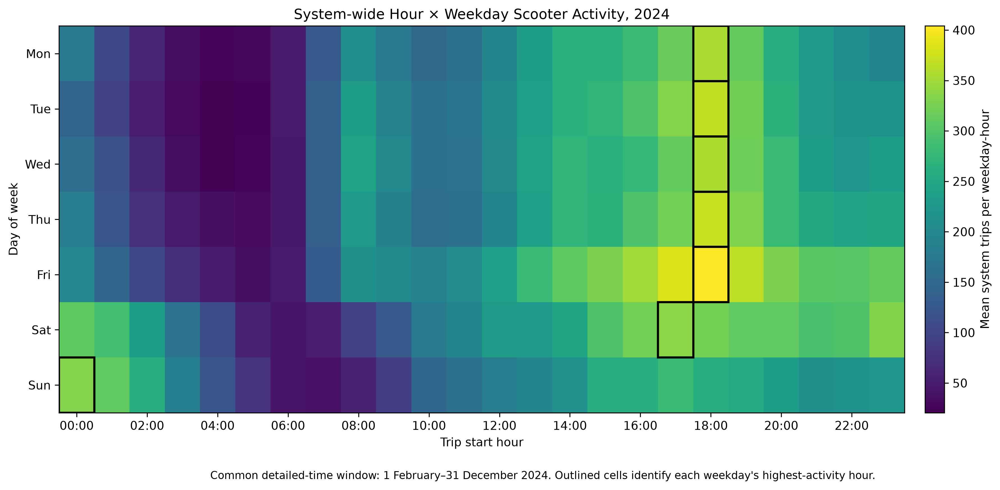
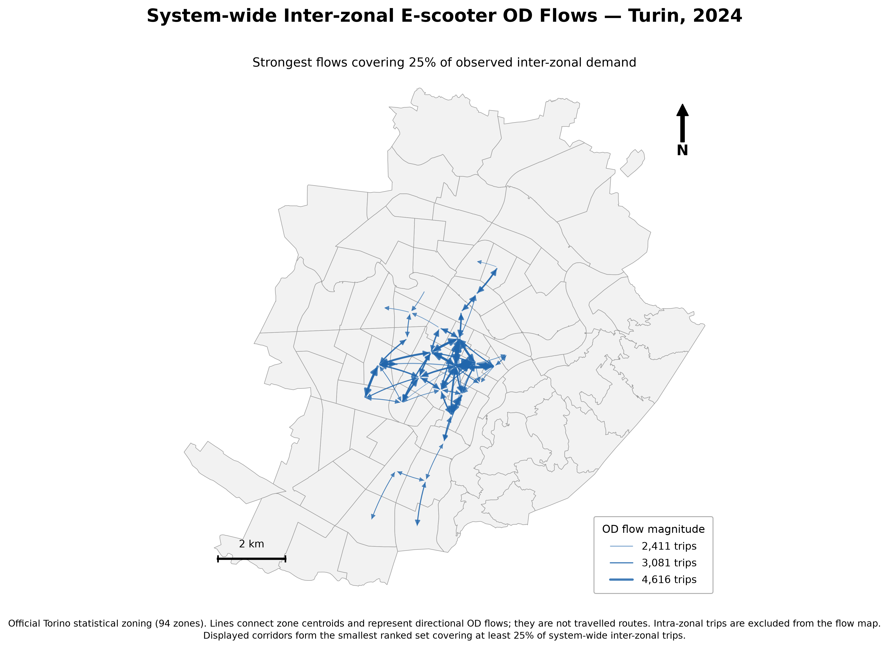
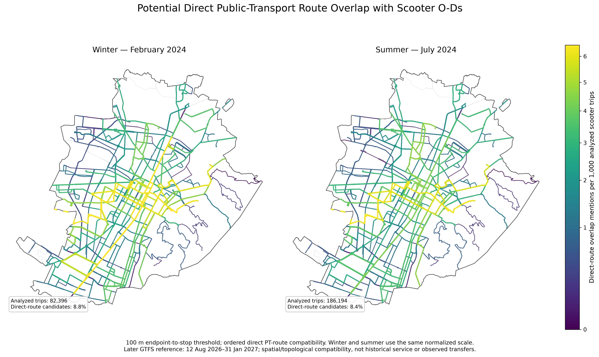
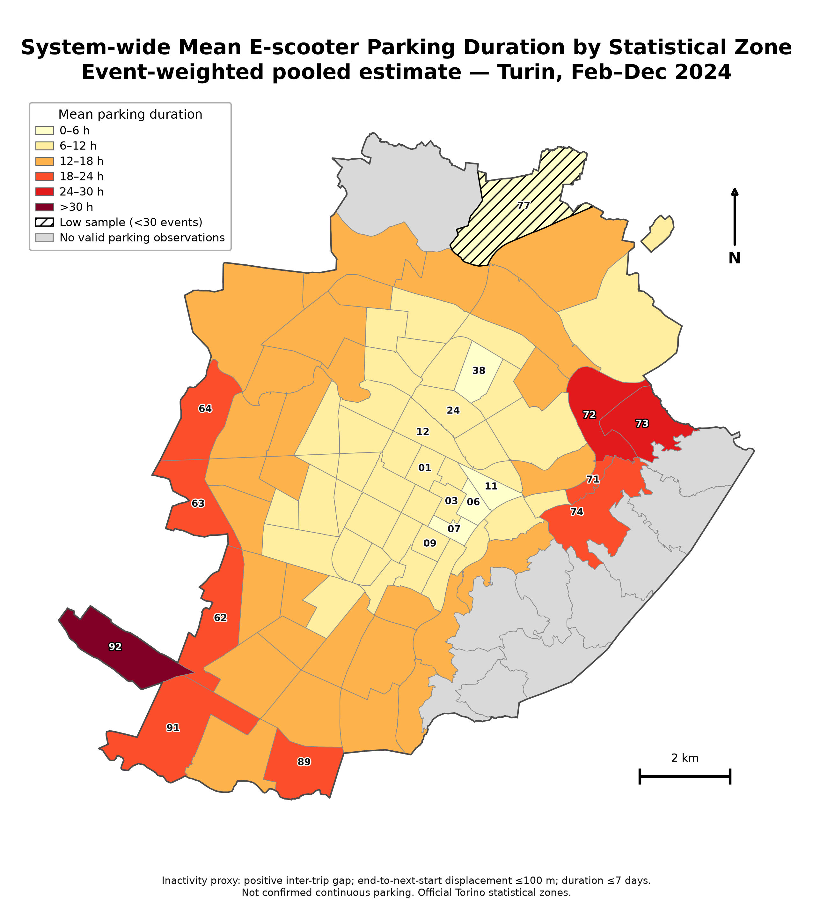
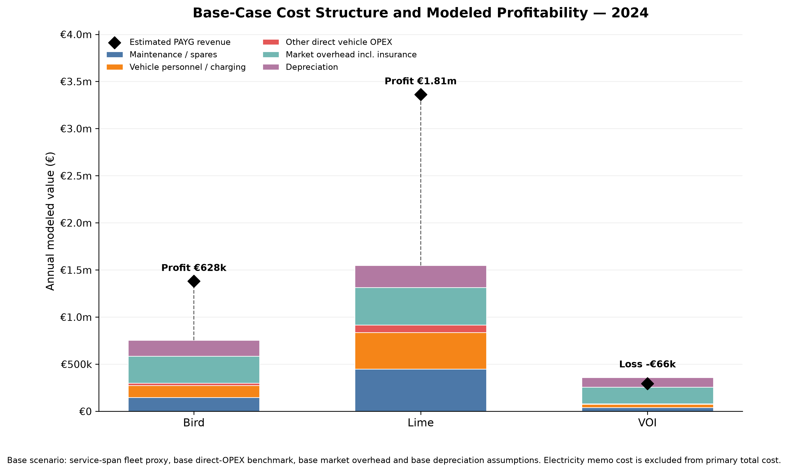

# Reproduced results and figure captions

These five figures were regenerated from supplied cleaned scooter records in an isolated workspace on 2026-10-14. [Validation coverage](../validation/figure-validation.md) and [source/output manifest](../validation/figure-evidence/selected-tables.json) define what was checked. CSVs preserve the numerical precision of the generated outputs; values below are rounded for reading. These are different analytical populations, not interchangeable denominators.

## Temporal usage

**1 February–31 December 2024:** 1,617,965 detailed-time trips over 335 calendar days, pooled across Bird, Lime and Voi. Each cell divides its trip count by the number of occurrences of that weekday (47 Wednesdays; 48 of each other weekday). The maximum is Friday 18:00–18:59: 19,394 trips / 48 Fridays = **404.04 trips per Friday at that hour**. Outlines mark each weekday's peak hour. The 18:00 hour is also the pooled daily-profile peak. Voi's month-only January is excluded. Unequal 2025 observation windows are not compared here. [Heatmap values](temporal_hour_weekday_2024.csv), [hourly values](temporal_hourly_2024.csv), [coverage registry](temporal_coverage.csv).

## Spatial OD

**Full 2024 zoned population:** 1,681,927 valid OD trips, including 1,409,705 interzonal trips. The 107 displayed directional pairs contain **354,646 / 1,409,705 = 25.16%** of interzonal trips: the smallest descending-volume set reaching 25%. Intra-zonal trips are omitted from this flow map. Arrows connect statistical-zone centroids, not observed routes; line widths use square-root scaling with a matching trip-count legend. The 94-zone boundary and 2 km scale provide spatial context. [Displayed pairs](od_displayed_core_2024.csv), [population totals](od_structural_summary_2024.csv).

## PT compatibility

**February and July 2024 scooter observations, later GTFS reference:** feed version 20260813 covers **12 August 2026–31 January 2027**. At the 100 m endpoint-to-stop threshold, ordered direct-route compatibility identifies **7,231 / 82,396 = 8.78%** candidates in February and **15,568 / 186,194 = 8.36%** in July. Colors show route mentions per 1,000 analyzed trips in each month on a shared scale. A trip may mention multiple routes; route mentions are not unique candidate trips. The unequal monthly populations are normalized, not compared as raw demand totals. This is later spatial/topological compatibility, not historical timetable service, actual transfers or demonstrated substitution. [System classification counts](pt_system_100m.csv), [operator and system classes](pt_classes_100m.csv), [route mentions](pt_route_mentions_100m.csv).

## Parking / operational inactivity

**February–December 2024:** **1,458,827 accepted intervals / 1,617,923 candidate intervals**. An accepted interval needs a next rental of the same vehicle, a positive resolved elapsed gap, an assigned destination zone, end-to-next-start displacement ≤100 m and duration ≤7 days. The map shows event-weighted zonal mean hours, with fixed duration classes; fewer than 30 events are hatched and no-observation zones are grey. The pooled mean across accepted events is **9.29 hours**, not the unweighted average of zone or operator means. Gaps are an operational-inactivity proxy and do not establish continuous physical parking. [Interval counts and operator summaries](parking_event_summary_2024.csv), [zonal values and operator weights](parking_zone_pooled_2024.csv).

## Economic scenario

**2024 tariff/benchmark scenario:** gross PAYG estimates cover 390,844 Bird, 1,196,200 Lime and 106,115 Voi trips. The base case combines a service-span-equivalent fleet proxy, benchmark direct operating costs, market overhead and depreciation. Estimated revenue minus modeled primary total cost produces operating-profit proxies of **€628,484 Bird**, **€1,814,759 Lime** and **−€65,871 Voi**. Diamonds mark revenue; stacked bars show cost components. Electricity is a separate memo/sensitivity cost, excluded from the primary total. These are scenario outputs, not audited operator profits; missing-duration cases use the pipeline's explicit lower-bound revenue treatment. [Full base-case values and denominators](economics_base_scenario_2024.csv), [assumptions](../../config/exercise_5/cost_assumptions_2024.csv), [tariffs](../../config/exercise_5/tariffs_2024.csv), [economic validation](../validation/exercise-5-reproduction.md).

The separate [commuting tables](commuting/) and [commuting validation](../validation/commuting-validation.md) concern one hypothetical home–Politecnico round trip and are not derived from these scooter trip records.
